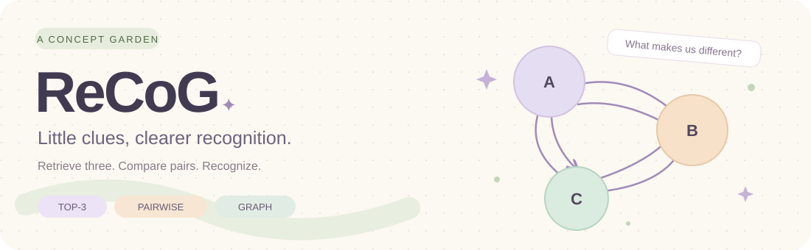

# 🌷 ReCoG

**개념 사이의 차이를 기억하고, 비교를 통해 인식합니다.**

[English](README.md) · [🧭 방법론](docs/methodology.md) · [🍵 가상 예시](docs/illustrated-example.md)

## 🪴 어떤 방법인가요?

ReCoG는 개념마다 독립적인 설명을 저장하는 데서 나아가, **다른 개념과
비교했을 때 구별되는 특징**을 그래프에 저장합니다. 질의 이미지가 들어오면
CLIP으로 후보 세 개를 검색하고, 후보 쌍을 각각 비교해 가장 많이 승리한
개념을 선택합니다.

| 단계 | 하는 일 | 코드 |
| :--- | :--- | :--- |
| 🌱 그래프 구축 | 개념 쌍마다 양방향 구별 특징 추출 | [graph.py](recog/graph.py) |
| 🔎 Top-3 검색 | 질의와 지원 이미지의 CLIP 코사인 유사도로 후보 선정 | [retrieval.py](recog/retrieval.py) |
| ⚖️ Pairwise matching | 질의·지원 이미지 두 장·방향별 특징으로 쌍별 판정 | [matching.py](recog/matching.py) |
| 🏅 최종 선택 | 승수 집계 후 동점이면 검색 유사도로 결정 | [pipeline.py](recog/pipeline.py) |

## 🧵 그래프의 엣지는 무엇인가요?

`A → B`는 **B와 비교할 때 A를 구별하는 특징**입니다. `B → A`와 서로 다른
설명이며, 숫자로 된 유사도 가중치가 아닙니다. 하나의 개념 쌍을 비교하는
VLM 호출에서 양쪽 특징을 각각 세 개씩 추출합니다.

추론에서는 후보가 A, B, C라면 **A–B, A–C, B–C의 세 경기**를 진행합니다.
각 경기는 한 개념에 1승을 부여하고, 최다 승리 개념을 선택합니다.

## 📖 읽는 순서

1. [전체 흐름](recog/pipeline.py)을 확인합니다.
2. [자료구조](recog/schemas.py)에서 노드와 방향별 특징의 형식을 봅니다.
3. [특징 추출·비교 프롬프트](recog/prompts.py)를 읽습니다.
4. [방법론 문서](docs/methodology.md)에서 수식과 입력·출력 계약을 확인합니다.

## 🍃 제공 범위

이 저장소는 **방법론을 읽고 이해하기 위한 간결한 코드**입니다. DB, 실제
이미지, 임베딩, 생성된 특징 캐시, 모델 가중치는 포함하지 않습니다.
이미지 인코딩과 VLM 연결은 호출자가 제공하는 인터페이스로 분리되어 있습니다.

Python 3.10 이상 문법과 표준 라이브러리를 사용합니다. 준비 과정에서 소스
문법과 파일 구성을 점검했으며, 예제 실행·모델 추론·벤치마크는 수행하지
않았습니다. 문서의 작은 예시는 전부 설명을 위해 만든 가상 내용입니다.

## 🤝 출처

R2P 기반 ReCoG 연구 구현을 바탕으로 정리했습니다.
기존 MIT 라이선스 고지는 [LICENSE](LICENSE)에 보존했습니다.
