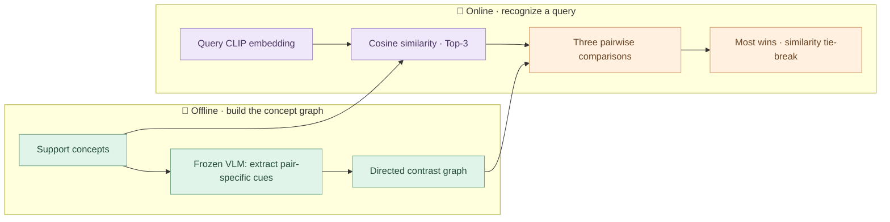

<div align="center">


# 🌷 ReCoG

**Recognize a concept by what makes it different.**

Frozen visual features · Directed contrastive cues · Pairwise reasoning

[🚀 Run](docs/running.md) · [🧭 Method](docs/methodology.md) · [🧩 Code](recog/pipeline.py) · [🍵 Illustrated example](docs/illustrated-example.md) · [🇰🇷 한국어](README.ko.md)

</div>

---

ReCoG represents personalized concepts as a graph. Each node holds a support
image and its visual embedding; each directed edge describes what makes one
concept different from another. Given a query, ReCoG retrieves **three candidates**,
compares each pair using their contrastive cues, and selects the concept with the
most wins.

This repository includes the **ReCoG method and runnable R2P components**:
CLIP encoding, MiniCPM model loading, prompts, local database preparation, and
R2P/ReCoG inference. Database contents, concept inventories, support images,
embeddings, generated feature caches, and model weights are not distributed.

## 🪴 The idea in one picture



## 🧵 Three small pieces

| Piece | What it does | Start reading |
| :--- | :--- | :--- |
| 🌱 **Graph construction** | Extracts both directional cue lists for every concept pair | [`build_graph`](recog/graph.py) |
| 🔎 **Top-3 retrieval** | Ranks support concepts by CLIP cosine similarity | [`retrieve_top3`](recog/retrieval.py) |
| ⚖️ **Pairwise matching** | Compares every candidate pair and aggregates wins | [`run_league`](recog/matching.py) |

For candidates **A, B, C**, the league contains **A vs B**, **A vs C**, and
**B vs C**. Each comparison contributes one win. A final tie is resolved using
the query-to-support CLIP similarity.

> 🍃 An edge is a **description**, not a similarity score.
> “A has a round handle compared with B” and “B has an angular handle compared
> with A” belong to different directed edges.

## 🚀 Run with your own local data

Use an isolated **Python 3.10** environment with a CUDA-capable PyTorch setup.

```bash
python -m pip install -r requirements.txt

# Prepare a local database from your own support manifest.
recog build --manifest /path/to/support-manifest.json --output private/database.json

# ReCoG: Top-3 → pairwise comparisons → league winner.
recog recognize --database private/database.json --query /path/to/query.jpg --method recog

# R2P: Top-3 → reasoning over unary concept descriptions.
recog recognize --database private/database.json --query /path/to/query.jpg --method r2p
```

`python -m recog` also works in place of `recog`. Model weights are loaded when
building or recognizing, so those commands require your model files or access to
Hugging Face. See the [execution guide](docs/running.md) for manifest fields,
existing R2P DB import, local checkpoints, and installation details.

> 🔒 Keep your data local. Generated DBs, JSON files, concept inventories, image
> files, and model weights are excluded from Git. There is no bundled DB list.

## 🗂️ A little map of the code

```text
ReCoG/
├── recog/
│   ├── schemas.py          # Concepts, directional evidence, and predictions
│   ├── graph.py            # Offline pairwise cue extraction
│   ├── retrieval.py        # CLIP cosine ranking → Top-3
│   ├── matching.py         # Round-robin comparisons → win counts
│   ├── runtime.py          # MiniCPM extraction, matching, and R2P selection
│   ├── storage.py          # Private local input/output formats
│   └── cli.py              # build / validate / recognize
├── r2p/
│   ├── retriever.py        # Frozen CLIP image encoder
│   ├── model_interface.py  # MiniCPM-o vision model loader
│   ├── mini_cpm_reasoning.py
│   ├── mini_cpm_reasoning_pairwise.py
│   ├── model_adapters.py   # MiniCPM message formatting
│   ├── prompt_generator.py
│   ├── compute_confidence.py
│   └── pairwise_loader.py  # Local pairwise/shared feature import
├── docs/                   # Method, execution guide, illustrated example
├── assets/                 # Pastel vector banner
├── tests/                  # Offline contract tests with temporary inputs
├── pyproject.toml
└── requirements.txt
```

## 📖 Reading the pipeline

The offline stage calls `build_graph(concepts, extract)` to obtain directional
cue lists. At inference time, the core ReCoG orchestration is:

```python
candidates = retrieve_top3(query_embedding, list(graph.nodes.values()))
prediction = run_league(query_image, candidates, graph, judge)
```

The CLI connects these functions to the included CLIP encoder and MiniCPM
backend. The method core uses the Python standard library; the optional
`runtime` installation supplies the model dependencies.

## 🍵 A tiny example

Imagine three fictional mugs: **Pebble**, **Ribbon**, and **Clover**. Pebble and
Ribbon may both be cream-colored, so color alone is unhelpful. A pair-specific
cue—such as a rounded handle versus an angular one—can separate them.

Follow a [hand-written retrieval and league example](docs/illustrated-example.md).
Its names, scores, descriptions, and results are invented for explanation;
they are not database records or experimental measurements.

## 📝 Scope and validation

- **Included:** R2P reasoning modules, concrete CLIP/MiniCPM integration, local DB
  build/import, directed graph construction, Top-3 retrieval, and both inference modes.
- **Private inputs:** your images, DB contents, concept lists, and generated features.
- **Checked:** offline unit/integration tests using temporary inputs and test doubles,
  runtime module imports, CLI help, source syntax, and package contents.
- **Not executed:** real-model inference, a dataset example, or benchmark evaluation.
  Model quality and hardware-specific end-to-end behavior remain unverified.

## 🤝 Acknowledgments

This code was prepared from the ReCoG research implementation built on R2P.
The upstream MIT notice is retained in [LICENSE](LICENSE); see [NOTICE.md](NOTICE.md)
for attribution. No benchmark performance or publication status is asserted here.
