<div align="center">

# 🐦🐧 ReCoG: Relational Concept Graph for Training-Free Personalization

 🇦🇺 **NeurIPS 2026**

Changseon Yu · Hyeokjun Kweon

 [Foundational Vision Laboratory](https://fovlab.cau.ac.kr/home),  Chung-Ang University

📄 Paper (coming soon) · [🚀 Run](docs/running.md) · [🧭 Method](docs/methodology.md)



</div>

## Abstract

Training-free personalization adapts a frozen vision-language model (VLM) to recognize
user-defined concepts from only a few exemplars by retrieving concept entries at inference
time. While recent retriever-based methods enrich each concept with descriptive evidence,
they largely treat concepts in isolation, so the retrieved information can be plausible yet
non-discriminative, especially when the personalized concept set contains highly confusable,
fine-grained categories. We argue that personalization is inherently **relational**: correct
recognition depends on the specific distinctions between a concept and its nearest
alternatives. To this end, we propose **ReCoG**, a **Re**lational **Co**ncept **G**raph for
retrieval-augmented personalization. ReCoG represents concepts as nodes and augments them with
directed edges that explicitly capture discriminative cues between concept pairs, elicited by a
frozen VLM during database construction. At inference, ReCoG retrieves a shortlist and resolves
ambiguity via explicit pairwise comparisons conditioned on the corresponding relational edges,
selecting the concept that consistently wins against competing candidates. We also introduce
**FINGER** benchmark to test personalized recognition on confusable concept sets. Across FINGER,
ReCoG substantially outperforms prior methods, with the largest gains in the most confusable
regimes. ReCoG also achieves consistently best performance on established personalization
benchmarks including captioning and VQA, confirming that relational evidence is broadly
beneficial beyond fine-grained settings.

## Method

**1. Relation-aware database.** For each pair of concepts $(c_i, c_j)$, a frozen VLM is asked
what makes $c_i$ different from $c_j$. The answer is stored as a directed edge

$$e_{ij} = \mathrm{VLM}(x_i^s, x_j^s \mid P_{\text{disc}}),$$

and $e_{ij} \neq e_{ji}$ in general. Both edges are obtained from a single VLM call per
unordered pair. Each concept entry stores its CLIP embedding and its outgoing edges.

**2. Discriminative retrieval via explicit comparison.** At inference, CLIP similarity prunes
the concept set to a shortlist $\mathcal{K}$. For every pair $(u, v)$ in $\mathcal{K}$, the
frozen VLM decides whether the query is closer to $c_u$ or $c_v$, conditioned on $e_{uv}$ and
$e_{vu}$. Wins are aggregated round-robin, and the concept with the most wins is returned
(ties are broken by CLIP similarity).

**3. Sparse ReCoG.** Instead of all $\mathcal{O}(N^2)$ pairs, edges are built only between each
concept and its top-$k$ CLIP neighbors, reducing database construction cost.

## FINGER Benchmark

**FINGER** (**FIN**e-**G**rained p**ER**sonalization) targets concept sets with high visual
confusability.

| Task | Source | Concepts | Images |
| :--- | :--- | :---: | :---: |
| CUB-Easy | 20 species sampled at random from CUB-200-2011 | 20 | 1 support + 19 queries per concept (400) |
| CUB-Hard | 20 visually similar species selected with CUB attributes (predominantly black birds) | 20 | 1 support + 19 queries per concept (400) |
| CLEVR | Each concept is a scene configuration; queries are rendered from different viewpoints | 20 | 1 support + 9 queries per concept (200) |

## Results

**Setup.** CLIP ViT-L for the database, MiniCPM-o-2.6 as the VLM, and a single reference image
per concept. P.Acc / N.Acc are accuracies on positive / negative queries, Wtd. is their average,
and Recall is the hard recall for captioning.

### FINGER benchmark

| Dataset | Method | P.Acc | N.Acc | Wtd. | Recall |
| :--- | :--- | :---: | :---: | :---: | :---: |
| **CUB-Easy** | R2P | 87.9 | 88.9 | 88.4 | 76.1 |
|  | Baseline | 50.0 | 97.3 | 73.7 | 65.0 |
|  | **ReCoG** | **96.3** | **99.8** | **98.1** | **80.8** |
| **CUB-Hard** | R2P | 63.8 | 98.1 | 81.0 | 55.0 |
|  | Baseline | 41.8 | 96.9 | 69.4 | 47.9 |
|  | **ReCoG** | **86.3** | **99.3** | **92.8** | **62.1** |
| **CLEVR** | R2P | 61.1 | 98.0 | 79.6 | 24.4 |
|  | Baseline | 51.7 | 97.5 | 74.6 | 14.8 |
|  | **ReCoG** | **87.2** | **99.3** | **93.3** | **41.7** |

Baseline uses R2P's relation-agnostic descriptions with pairwise retrieval. On Wtd., ReCoG
outperforms R2P by **+9.7**, **+11.8**, and **+13.7** points on CUB-Easy, CUB-Hard, and CLEVR.

### CLEVR difficulty (P.Acc / N.Acc)

$K$ is scene complexity; 1-hop concepts differ by a smaller change than 2-hop concepts.

| $K$ | Method | 1-hop | 2-hop |
| :---: | :--- | :---: | :---: |
| 4 | R2P | 61.7 / 63.8 | 75.0 / 83.2 |
|   | Baseline | 52.8 / 98.0 | 68.3 / 98.8 |
|   | **ReCoG** | **91.4 / 99.7** | **91.7 / 99.6** |
| 5 | R2P | 53.8 / 60.5 | 72.2 / 80.9 |
|   | Baseline | 36.1 / 96.6 | 50.5 / 97.4 |
|   | **ReCoG** | **76.6 / 98.7** | **82.2 / 99.1** |
| 6 | R2P | 46.6 / 53.4 | 68.4 / 70.9 |
|   | Baseline | 30.0 / 96.3 | 40.0 / 96.8 |
|   | **ReCoG** | **74.4 / 98.6** | **81.4 / 98.4** |

### Established benchmarks

Recognition and captioning on MyVLM, Yo'LLaVA, and PerVA:

| Dataset | Method | P.Acc | N.Acc | Wtd. | Recall |
| :--- | :--- | :---: | :---: | :---: | :---: |
| **MyVLM** | MyVLM | 96.6 | 90.9 | 93.8 | 0.02 |
|  | Yo'LLaVA | 97.0 | 95.7 | 96.4 | 0.1 |
|  | RAP | 94.4 | 98.8 | 96.6 | 88.0 |
|  | R2P | 96.3 | 98.5 | 97.4 | 91.4 |
|  | **ReCoG** | **98.6** | **99.9** | **99.3** | **92.9** |
| **Yo'LLaVA** | MyVLM | - | - | - | - |
|  | Yo'LLaVA | 94.9 | 89.8 | 92.4 | 0.2 |
|  | RAP | 86.0 | 99.2 | 92.2 | 79.7 |
|  | R2P | 91.1 | 97.7 | 94.4 | 87.1 |
|  | **ReCoG** | **95.0** | **99.9** | **97.4** | **90.4** |
| **PerVA** | MyVLM | 66.0 | 58.5 | 62.2 | - |
|  | Yo'LLaVA | 75.1 | 69.0 | 72.0 | - |
|  | RAP | 92.9 | 85.2 | 89.0 | 64.1 |
|  | R2P | 90.2 | 92.8 | 91.8 | 72.5 |
|  | **ReCoG** | **97.7** | **99.9** | **98.8** | **73.7** |

VQA on Yo'LLaVA:

| Method | Yo'LLaVA | RAP | GPT-4V+VP | LLaVA | R2P | **ReCoG** |
| :--- | :---: | :---: | :---: | :---: | :---: | :---: |
| Accuracy | 92.9 | 93.2 | 86.6 | 89.9 | 96.5 | **97.0** |

### Sparse ReCoG

On CUB-Hard, Sparse ReCoG with $k=1$ already outperforms R2P while requiring only 13 VLM
calls for graph construction. With $k=2$, it reaches **85.0%** P.Acc using only **26** VLM
calls, close to the full ReCoG performance of **86.3%** obtained with all 190 pairwise edges.

## Getting started

Use an isolated **Python 3.10** environment with a CUDA-capable PyTorch setup.

```bash
python -m pip install -r requirements.txt

# Prepare a local database from your own support manifest.
recog build --manifest /path/to/support-manifest.json --output private/database.json

# ReCoG: Top-3 → pairwise comparisons → league winner.
recog recognize --database private/database.json --query /path/to/query.jpg --method recog

# R2P: Top-3 → reasoning over unary concept descriptions.
recog recognize --database private/database.json --query /path/to/query.jpg --method r2p
```

`python -m recog` also works in place of `recog`. See the [execution guide](docs/running.md)
for manifest fields, existing R2P DB import, local checkpoints, and installation details.
Database contents, concept inventories, support images, embeddings, and model weights are not
distributed and stay local.

## Code structure

```text
ReCoG/
├── recog/
│   ├── schemas.py          # Concepts, directional evidence, and predictions
│   ├── graph.py            # Offline pairwise cue extraction
│   ├── retrieval.py        # CLIP cosine ranking → Top-3
│   ├── matching.py         # Round-robin comparisons → win counts
│   ├── runtime.py          # MiniCPM extraction, matching, and R2P selection
│   ├── storage.py          # Private local input/output formats
│   └── cli.py              # build / validate / recognize
├── r2p/                    # R2P reasoning modules, CLIP encoder, MiniCPM loader
├── docs/                   # Method, execution guide, illustrated example
├── assets/                 # README figure
├── tests/                  # Offline contract tests with temporary inputs
├── pyproject.toml
└── requirements.txt
```

## Notes

The numbers above are reported in the paper. This repository's code has been checked with
offline unit/integration tests; real-model inference and benchmark evaluation have not been
re-run from this repository.

## Acknowledgments

This code was prepared from the ReCoG research implementation built on
R2P. The upstream MIT notice is retained in [LICENSE](LICENSE); see
[NOTICE.md](NOTICE.md) for attribution.
