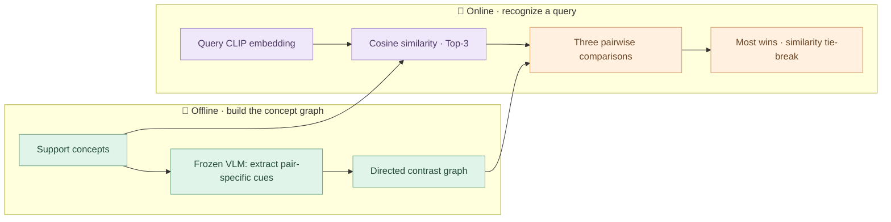

<div align="center">


# 🌷 ReCoG

**Recognize a concept by what makes it different.**

Frozen visual features · Directed contrastive cues · Pairwise reasoning

[🧭 Method](docs/methodology.md) · [🧩 Code](recog/pipeline.py) · [🍵 Illustrated example](docs/illustrated-example.md) · [🇰🇷 한국어](README.ko.md)

</div>

---

ReCoG represents personalized concepts as a graph. Each node holds a support
image and its visual embedding; each directed edge describes what makes one
concept different from another. Given a query, ReCoG retrieves **three candidates**,
compares each pair using their contrastive cues, and selects the concept with the
most wins.

This repository presents the **core methodology in compact Python**. Database
contents, support images, embeddings, generated feature caches, and model weights
are not distributed. Model adapters are explicit interfaces; this is not a
packaged end-to-end experiment runner.

## 🪴 The idea in one picture



## 🧵 Three small pieces

| Piece | What it does | Start reading |
| :--- | :--- | :--- |
| 🌱 **Graph construction** | Extracts both directional cue lists for every concept pair | [`build_graph`](recog/graph.py) |
| 🔎 **Top-3 retrieval** | Ranks support concepts by CLIP cosine similarity | [`retrieve_top3`](recog/retrieval.py) |
| ⚖️ **Pairwise matching** | Compares every candidate pair and aggregates wins | [`run_league`](recog/matching.py) |

For candidates **A, B, C**, the league contains **A vs B**, **A vs C**, and
**B vs C**. Each comparison contributes one win. A final tie is resolved using
the query-to-support CLIP similarity.

> 🍃 An edge is a **description**, not a similarity score.
> “A has a round handle compared with B” and “B has an angular handle compared
> with A” belong to different directed edges.

## 🗂️ A little map of the code

```text
ReCoG/
├── recog/
│   ├── schemas.py          # Concepts, directional evidence, matches, predictions
│   ├── graph.py            # Offline pairwise cue extraction
│   ├── retrieval.py        # CLIP cosine ranking → Top-3
│   ├── prompts.py          # Extraction and comparison instructions
│   ├── matching.py         # Round-robin comparisons → win counts
│   └── pipeline.py         # The online method in two calls
├── docs/
│   ├── methodology.md      # Definitions, equations, and interface contracts
│   └── illustrated-example.md
├── assets/
│   └── recog-banner.svg
├── README.ko.md
├── NOTICE.md
└── LICENSE
```

## 📖 Reading the pipeline

The offline stage calls `build_graph(concepts, extract)`. The `extract` adapter
passes two support images to a frozen VLM and returns three distinctive cues per
direction. At inference time, the entire orchestration is:

```python
candidates = retrieve_top3(query_embedding, list(graph.nodes.values()))
prediction = run_league(query_image, candidates, graph, judge)
```

The caller supplies CLIP embeddings and a `judge` adapter that compares the query
with two support images. The core uses the Python standard library and targets
**Python 3.10+**. It does not load a model, read a database, or download assets on
import. See the [adapter contracts](docs/methodology.md#-adapter-contracts) for the
expected image order and outputs.

## 🍵 A tiny example

Imagine three fictional mugs: **Pebble**, **Ribbon**, and **Clover**. Pebble and
Ribbon may both be cream-colored, so color alone is unhelpful. A pair-specific
cue—such as a rounded handle versus an angular one—can separate them.

Follow a [hand-written retrieval and league example](docs/illustrated-example.md).
Its names, scores, descriptions, and results are invented for explanation;
they are not database records or experimental measurements.

## 📝 Scope

- **Included:** directed graph construction, Top-3 cosine retrieval, pairwise
  prompts, league scoring, and final tie-breaking.
- **External inputs:** images, CLIP embeddings, and frozen VLM adapters.
- **Validation:** source syntax and repository contents were reviewed. No example,
  model inference, or benchmark was executed for this preparation.

## 🤝 Acknowledgments

This code was prepared from the ReCoG research implementation built on R2P.
The upstream MIT notice is retained in [LICENSE](LICENSE); see [NOTICE.md](NOTICE.md)
for attribution. No benchmark performance or publication status is asserted here.
